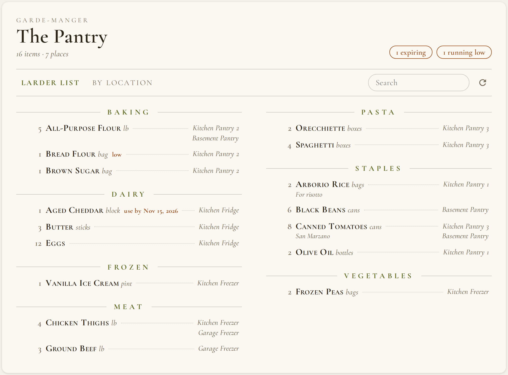
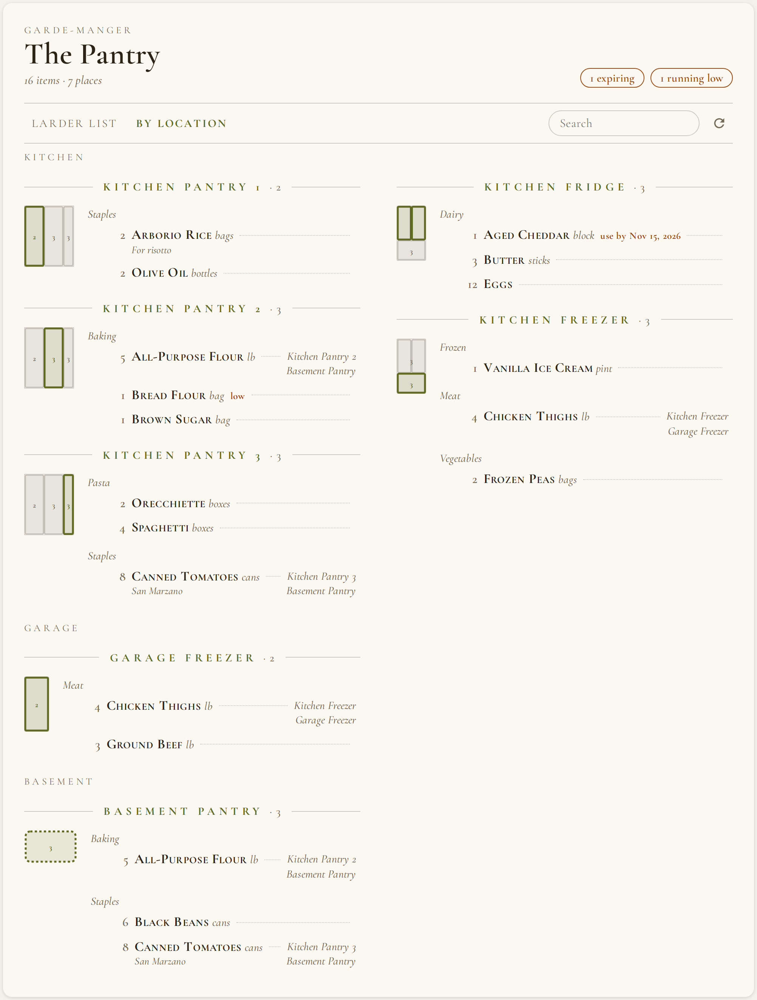
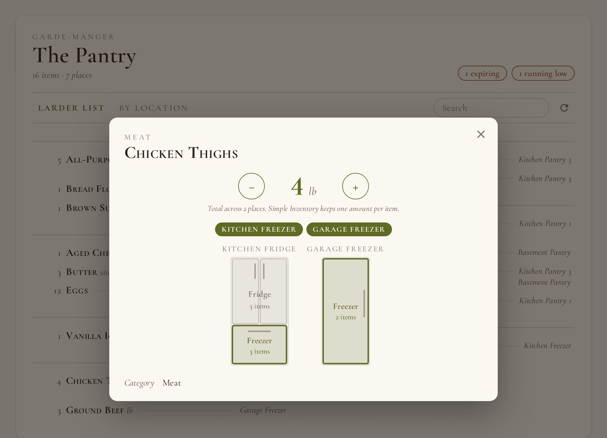
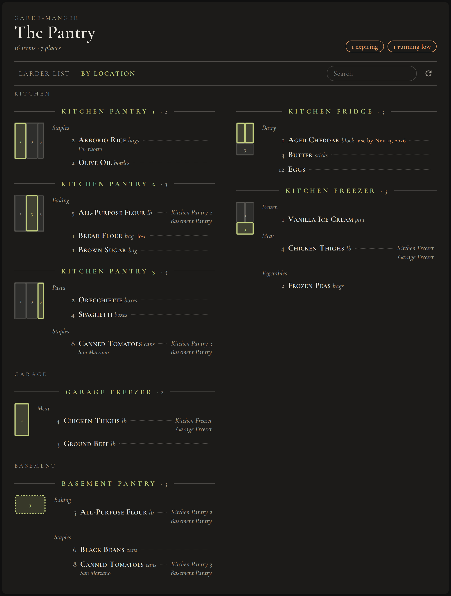

# Pantry Larder Card

A Home Assistant Lovelace card that shows a [Simple Inventory](https://github.com/blaineventurine/simple_inventory) pantry as a printed larder list, with your storage drawn to scale.

- **Larder list:** items grouped by category, with amount, unit, notes, use-by and low-stock flags, and where each one is kept.
- **By location:** every storage place with a small diagram (cabinets, French-door fridge, side-by-side fridge, upright freezer, or a plain room), and its contents by category.
- **Item dialog:** tap an item to see its amount with plus and minus buttons, and every place it's stored, highlighted on the diagrams.
- Follows your Home Assistant theme in light and dark mode.





| Item dialog | Dark theme |
| --- | --- |
|  |  |

Screenshots use made-up demo data.

## Requirements

- Home Assistant 2024.8 or later.
- The [Simple Inventory](https://github.com/blaineventurine/simple_inventory) integration, with at least one inventory.

## Installation

### HACS

1. In HACS, open the menu and choose **Custom repositories**.
2. Add `https://github.com/mikecb/ha-pantry-larder-card` with the type **Dashboard**.
3. Install **Pantry Larder Card**, then reload your browser.

### Manual

Copy both files from `dist/` into `config/www/pantry-larder-card/`, then add `/local/pantry-larder-card/pantry-larder-card.js` as a JavaScript module resource. Keep the two files together; the card loads its fonts from the file next to it.

## Configuration

```yaml
type: custom:pantry-larder-card
inventory: sensor.pantry_inventory
```

| Option | Default | Description |
| --- | --- | --- |
| `inventory` | `sensor.pantry_inventory` | The Simple Inventory sensor for the inventory to show. |
| `title` | `The Pantry` | The heading. |
| `view` | `items` | The tab to open on: `items` or `location`. |
| `appliances` | none | Your storage layout. Without it, each location shows as a plain block. |

### Describing your storage

Each entry in `appliances` is one piece of storage. Each of its `parts` is one Simple Inventory location, matched by name. Sizes are in inches and only set the drawing's proportions.

| Kind | Parts | Drawing |
| --- | --- | --- |
| `run` | 1 or more | A row of cabinets side by side. Give each part a width `w`; `h` is the cabinet height. |
| `frenchdoor` | 2: fridge, freezer drawer | French doors over a bottom freezer drawer. |
| `sidebyside` | 2: freezer side, fridge side | A side-by-side fridge, freezer on the left. |
| `upright` | 1 | An upright fridge or freezer. |
| `room` | 1 | A dashed outline, for closets, rooms or shelving without a fixed shape. |

`area` groups appliances under a heading such as Kitchen or Basement. Locations that don't appear in `appliances` are still shown, under "Elsewhere".

```yaml
type: custom:pantry-larder-card
inventory: sensor.pantry_inventory
appliances:
  - name: Kitchen pantry
    area: Kitchen
    kind: run
    h: 78
    parts:
      - { loc: Kitchen Pantry 1, label: "1", w: 24 }
      - { loc: Kitchen Pantry 2, label: "2", w: 24 }
      - { loc: Kitchen Pantry 3, label: "3", w: 12 }
  - name: Kitchen fridge
    area: Kitchen
    kind: frenchdoor
    w: 36
    h: 70
    parts:
      - { loc: Kitchen Fridge, label: Fridge }
      - { loc: Kitchen Freezer, label: Freezer }
  - name: Garage freezer
    area: Garage
    kind: upright
    w: 30
    h: 70
    parts:
      - { loc: Garage Freezer, label: Freezer }
  - name: Basement pantry
    area: Basement
    kind: room
    parts:
      - { loc: Basement Pantry }
```

## Notes

- Simple Inventory keeps one amount per item, even when an item is stored in more than one place. The card shows that total, and the plus and minus buttons change it.
- The card reloads when the inventory sensor changes, and every five minutes otherwise.

## License

MIT, see [LICENSE](LICENSE) and [NOTICE](NOTICE). The bundled Cormorant Garamond font is © the Cormorant Project Authors and licensed under the [SIL Open Font License 1.1](OFL.txt).
